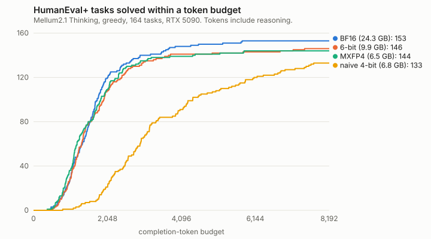

# Mellum MLX

Benchmarked MLX quantizations of JetBrains' [Mellum2.1-12B-A2.5B-Thinking](https://huggingface.co/JetBrains/Mellum2.1-12B-A2.5B-Thinking) (12B MoE, 2.5B active) for Apple Silicon. Every number below comes from a full 164-task HumanEval+ run or a measured M4 MacBook Pro, with raw responses and receipts in this repo.

**Model:** [imaadd05/Mellum2.1-12B-A2.5B-Thinking-mlx-6bit-g64](https://huggingface.co/imaadd05/Mellum2.1-12B-A2.5B-Thinking-mlx-6bit-g64) (9.87 GB, MLX 6-bit affine, group 64).

```sh
python -m pip install 'mlx==0.32.3' 'mlx-lm==0.32.0'
python -m mlx_lm generate --model imaadd05/Mellum2.1-12B-A2.5B-Thinking-mlx-6bit-g64 \
  --prompt 'Find the bug: def mean(xs): return sum(xs) / len(xs) - 1' \
  --temp 0.6 --top-p 0.95 --top-k 20 --max-tokens 16384
```

**Write-up:** [Two 4-bit quantizations, same size class. One made the model think twice as long.](docs/WRITEUP.md)

## Which model for which Mac

| Your Mac | Use | Why |
| --- | --- | --- |
| Any, including 16 GB | [randmaru MXFP4](https://huggingface.co/randmaru/Mellum2.1-12B-A2.5B-Thinking-mlx-mxfp4) | Ties 6-bit on HumanEval+ (144 vs 146, p = 0.80), decodes 34–41% faster on the M4 and peaks at 7.2 GB. |
| 24 GB or more, want the closest to BF16 | [This 6-bit](https://huggingface.co/imaadd05/Mellum2.1-12B-A2.5B-Thinking-mlx-6bit-g64) | Fewest losses against BF16 (1 vs 8 discordant tasks), but the edge over MXFP4 is not significant. Peaks at 10.5 GB and swapped on a 16 GB M4. |

I tried to beat MXFP4 for 16 GB (mixed 4/6-bit recipes, group-32 experts, DWQ calibration, and last MXFP4 with 8-bit attention). The best of them only tied it and was slower, so I recommend MXFP4 rather than publish a near-duplicate. My own 6-bit is the right pick only if you want the closest quantization to BF16 and have the memory.

## Results



164 HumanEval+ tasks, same RTX 5090, upstream chat template, greedy decoding, 8,192 completion tokens (reasoning included), one sample per task:

| Model | Weights | HumanEval+ | Hit budget | Median tokens | M4 decode tok/s (1K / 16K) |
| --- | ---: | ---: | ---: | ---: | ---: |
| BF16 original | 24.3 GB | 153 (93.3%) | 3 | 1,571 | n/a |
| **6-bit (released)** | 9.87 GB | 146 (89.0%) | 3 | 1,521 | 47.2 / 42.8 |
| randmaru MXFP4 | 6.46 GB | 144 (87.8%) | 6 | 1,544 | 66.7 / 57.4 |
| MXFP4 + 8-bit attention (not released) | 6.77 GB | 145 (88.4%) | 3 | 1,632 | 55.0 / 49.0 |
| Affine 4-bit (not released) | 6.84 GB | 133 (81.1%) | 18 | 3,242 | n/a |

M4 numbers: 14-inch MacBook Pro, M4, 16 GB, 256 output tokens, mean of three trials after warmup. 6-bit and MXFP4 ran back to back in one session; the 8-bit-attention candidate ran with a second MXFP4 run (65.7 / 57.1) minutes earlier. Full tables, paired statistics, receipts and limitations: [docs/RESULTS.md](docs/RESULTS.md).

## Findings

- **Affine 4-bit writes 2.2x longer completions than BF16, mostly reasoning,** on the same tasks (paired Wilcoxon p = 5e-25, n = 144), and hits the token budget mid-thought on 18 of 164. MXFP4 is smaller and stays at BF16's length. Pass@1 alone hides this. See the [write-up](docs/WRITEUP.md).
- **Extra attention bits cost speed in a small-active MoE.** Attention is about a quarter of the weights read per token, so 8-bit attention over MXFP4 decoded 14–17% slower on the M4 and gained no measurable accuracy.
- **MLX-LM 0.32.0 drops unparseable tool calls silently**: the response keeps `finish_reason: "tool_calls"` but `tool_calls` is empty. A tested patch is in [patches/](patches/). The same bug has an open upstream fix, [ml-explore/mlx-lm#1957](https://github.com/ml-explore/mlx-lm/pull/1957).
- **Mellum's template replays prior reasoning only from `reasoning_content`**, but the server returns `reasoning`, so clients that echo messages back lose earlier thinking between tool steps.
- **Repository-agent trials are weak evidence**: one task, 1 success of 3 seeds after patches. Not a reliability claim.

Quantization methods and the model architecture come from upstream projects. This repository contributes the measurement and integration work.

## Reproduce

Python 3.12 was used. Keep the model cache and environments inside the checkout:

```sh
python3 -m venv .venv
. .venv/bin/activate
export HF_HOME="$PWD/work/hf-cache"
python -m pip install -r requirements.txt
# Linux CUDA 13 only; supported NVIDIA driver required:
python -m pip install 'mlx[cuda13]==0.32.3'
# Or reproduce the complete tested Linux environment:
# python -m pip install -r requirements-cuda.lock

python scripts/convert.py --bits 4
python scripts/validate.py artifacts/mellum2.1-affine-4bit-g64
python scripts/convert.py --bits 6
python scripts/validate.py artifacts/mellum2.1-affine-6bit-g64
```

On Apple Silicon, install `requirements.txt` and omit the CUDA install. Conversion downloads about 24.3 GB of BF16 weights and requires sufficient RAM/VRAM and disk space; the conversion has not been tested on a 16 GB Mac. On a 16 GB Mac, download a released artifact (see the table above) rather than assuming conversion fits that machine.

The converter refuses to overwrite an existing artifact. A `conversion.json` receipt records source revision, software versions, quantization settings and SHA-256 checksums. Tokenizer and template files are preserved byte-for-byte. Weight files and caches are excluded from Git.

## Evaluate

```sh
python -m unittest discover -s tests -v
python scripts/score.py work/source --output results/local/bf16.json
python scripts/score.py artifacts/mellum2.1-affine-4bit-g64   --baseline results/local/bf16.json --output results/local/4bit.json
python scripts/protocol_probe.py artifacts/mellum2.1-affine-4bit-g64   --output results/local/protocol.json
python scripts/benchmark.py artifacts/mellum2.1-affine-4bit-g64   --context 1024 --max-tokens 256 --trials 3 --output results/local/benchmark-1k.json
python scripts/http_probe.py artifacts/mellum2.1-affine-4bit-g64 \
  --output results/local/http.json
python scripts/cache_probe.py artifacts/mellum2.1-affine-4bit-g64 \
  --output results/local/cache.json
```

`score.py` is an authored short-snippet regression probe, **not** a representative coding benchmark. It never executes model-generated code. `protocol_probe.py` checks fixed parser/serializer fixtures; passing it does not establish live HTTP or coding-agent reliability. `benchmark.py` uses a synthetic repeated-code prefix and greedy generation; reported MLX memory excludes OS memory and swap. CUDA and Metal results must remain separate. `cache_probe.py` compares the last eight positions of synthetic sequences around the sliding-window boundary; its differences are diagnostics, not a numerical parity pass.

For an independent short-context reference, create a separate environment, install CPU `torch==2.14.1` from the [official CPU wheel index](https://download.pytorch.org/whl/cpu), plus `transformers==5.19.0`, `numpy==2.5.3`, and `safetensors==0.8.0`, then run:

```sh
python scripts/reference_score.py work/source   --mlx-reference results/cuda/bf16-probe.json   --output results/local/transformers-bf16.json
```

For isolated executable coding comparisons, see [the fixed HumanEval+ protocol](docs/CODING_PROTOCOL.md). Full samples, outcomes and provenance limitations are published in [measurement notes](docs/RESULTS.md).

Reports refuse to overwrite prior measurements.

## Provenance and attribution

- Model: [JetBrains/Mellum2.1-12B-A2.5B-Thinking](https://huggingface.co/JetBrains/Mellum2.1-12B-A2.5B-Thinking), revision `92ddae9fc7665e9f801d141d2e5a6b2caf2460c4`, Apache-2.0. JetBrains created and trained the model.
- Runtime: [MLX-LM](https://github.com/ml-explore/mlx-lm), tested package `0.32.0`; [MLX](https://github.com/ml-explore/mlx), `0.32.3`.
- Quantization: native affine group size 64; 4 or 6 bits for eligible weights, native 8-bit Mellum routers, remaining weights BF16. Experimental recipes (`--recipe A|B|C|D|M`) are documented in the research archive. Router protection is upstream behaviour, not a novel method introduced here.
- External comparator: [randmaru MXFP4](https://huggingface.co/randmaru/Mellum2.1-12B-A2.5B-Thinking-mlx-mxfp4), revision `4ce0d28df07dfa4ed28077e5b718e866be2cf4cf`. Credit belongs to its publisher.
- This repository's original scripts: MIT. The MIT license does not relicense JetBrains' weights or third-party code.

## Research archive

The experiments that didn't ship are documented with their pre-registered rules, failed attempts and receipts: [mixed non-expert precision](docs/research/NONEXPERT_EXPERIMENT.md), [group-32 and bounded DWQ](docs/research/REFINEMENT_EXPERIMENT.md), [DWQ learning-rate diagnostic](docs/research/DWQ_DIAGNOSTIC.md), [calibration v2](docs/research/CALIBRATION_V2.md), and the final [MXFP4 + 8-bit attention run](docs/RESULTS.md#final-experiment-mxfp4--8-bit-attention-not-shipped). The release plan and ship rule are in [docs/PLAN.md](docs/PLAN.md).
